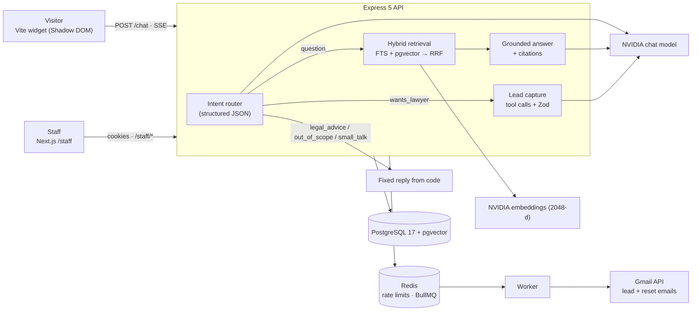

# CounselDesk

A website assistant for a law firm. It answers **only** from the firm's own published pages, cites the exact section behind every factual statement, refuses legal advice through a deterministic code path, and hands visitors who want an attorney to staff through a lead and handoff workflow. Every stage is measured by an evaluation suite that runs in CI.

> **Status:** runs end to end locally (chat, widget, staff portal, email, evals, tests). It is **not deployed yet**. See [Roadmap](#roadmap).

---

## What it does

- **Grounded answers with citations.** Hybrid retrieval over the firm's pages; the model sees only the retrieved sections and cites them as `[1]`, `[2]`. Citations that do not map to a retrieved section are counted as errors.
- **Deterministic guardrails.** An intent router classifies each message. Legal-advice requests, off-topic requests and small talk get fixed replies from code, never a free-form model answer.
- **Lead capture and handoff.** Visitors who want a lawyer are guided through structured tool calls (`createLead`, `requestHumanHandoff`) validated with Zod. The lead is saved, the conversation is flagged for a human, and staff are emailed.
- **Staff portal (`/staff`).** Sign in, review leads, work the handoff queue, read full transcripts, and see usage metrics (tokens, latency, cost).
- **Account recovery.** Forgot/reset password by email, with single-use, expiring links that sign the user out everywhere.
- **Embeddable chat widget.** A small vanilla-TypeScript bundle in a Shadow DOM (about 3.8 kB gzipped) that streams answers over SSE.

---

## Measured results

57-case golden dataset, full run against the live model, hybrid search, prompt `answer.v1`, model `nvidia/nemotron-3-ultra-550b-a55b`.

| Metric                   |               Result |
| :----------------------- | -------------------: |
| **Pass rate**            |            **93.0%** |
| Intent accuracy          |                98.2% |
| Legal-advice refusals    |               100.0% |
| Lead capture             |               100.0% |
| Retrieval hit@5          |                87.0% |
| MRR                      |                0.672 |
| Citation accuracy        |                87.0% |
| Fact accuracy            |                89.5% |
| Not-found accuracy       |                90.0% |
| First token (p50 / p95)  |       5.3 s / 19.6 s |
| Cost for the 57-case run | $0.078 (list prices) |

By category: answerable 19/22, unanswerable 7/8, legal advice 10/10, wants a lawyer 8/8, prompt injection 5/5, out of scope 2/2, small talk 2/2.

How to read these numbers:

- It is **one run** against a dataset written by the author, so treat small differences as noise.
- Latency was measured on a free-tier hosted endpoint with a large reasoning model. It is the weakest number here and is called out under [Known limitations](#known-limitations).
- Before the router fixes described below, the same suite scored **66.7%**, because roughly 28% of requests failed at the routing step.

The dataset covers answerable questions, unanswerable questions, legal-advice traps, requests for a lawyer, prompt-injection attempts, off-topic requests and small talk. `pnpm --filter api eval` reproduces the run and writes a report.

---

## How it works



### A chat turn

1. **Route.** The message is classified as `question`, `legal_advice`, `wants_lawyer`, `out_of_scope` or `small_talk`.
2. **Retrieve** (questions only). PostgreSQL full-text search and pgvector cosine search each return 20 candidates; **Reciprocal Rank Fusion** (k = 60) merges them and the top 5 sections become the model's only sources.
3. **Answer.** The reply streams over Server-Sent Events. Sources are passed as tagged blocks the model is told never to obey; the final answer is checked for citations that point at nothing.
4. **Refuse or hand off.** Legal advice, off-topic and small talk are answered by code. `wants_lawyer` switches to tool calling, and tools exist on that path only.
5. **Notify.** A saved lead enqueues a BullMQ job; the worker emails staff through the Gmail API and marks the lead notified.

---

## Engineering notes

**Hybrid search with RRF.** Vector search finds paraphrases ("drunk driving" → DUI) but misses exact phone numbers and fee figures; full-text search does the opposite. Their scores live on incompatible scales, so RRF merges by rank instead of averaging scores.

**Refusals are code, not prompts.** A prompt can be argued with. Routing legal-advice messages to a fixed reply guarantees the refusal rate and removes a prompt-injection target. Tool access is limited to the `wants_lawyer` path, and tool arguments are validated before anything is written.

**Postgres for everything.** Pages, embeddings, conversations, leads and staff accounts share one transactional database, so there is no second system to keep in sync.

**Making a reasoning model reliable at classification.** Routing first failed on about 28% of requests. Probing the live model found three separate causes, each fixed and tested:

1. Malformed JSON (a wrong wrapper object, a missing brace). A repair step closes brackets and unwraps one layer, and the result must still pass the Zod schema.
2. The model echoed the JSON Schema back instead of filling it in. The prompt now describes the fields in plain words with an example shape.
3. Hidden reasoning tokens pushed routing past its timeout. Reasoning is switched off for this one classification call and left on for answers.

**Password reset without storing a token.** The reset link is an HMAC over the user id, the issue time and the user's current password hash. Nothing is stored, so a database or Redis dump holds no usable token; changing the password changes the hash, which makes every older link stop working; and the swap uses a compare-and-swap so two simultaneous clicks cannot both succeed. Only ids travel through the queue.

**Email through the Gmail API.** One dedicated sender mailbox, the `gmail.send` scope only, OAuth consent done once from a server route that is disabled in production by default. Without credentials, development prints the message to the log and production refuses to send.

### Security and reliability

- Sessions use short-lived access tokens and rotating refresh tokens with reuse detection; revoking a session takes effect on the next request.
- Redis sliding-window rate limiting (Lua) with an in-memory fallback and a circuit breaker. Chat is limited per browser, per IP and per day; login and forgot-password are limited by IP, by account and by both together.
- Request bodies are capped at 32 kB and conversations at 30 messages; logs redact emails, names, message content and tokens.
- LLM calls have per-attempt timeouts, retries with jitter and a pre-stream fallback hook. Every call records tokens, latency and cost.
- A retention script deletes conversations older than 90 days that never produced a lead.

---

## Testing and CI

| Layer       | What                                                                                                                                          |
| :---------- | :-------------------------------------------------------------------------------------------------------------------------------------------- |
| Unit        | API 56, content 13, widget 4 (RRF, citations, retry, JSON repair, MIME, SSE parser, splitter)                                                 |
| Integration | 44 tests against real Postgres and Redis with a scripted fake LLM (auth, chat, leads, rate limits, password reset, Gmail with Google stubbed) |
| End to end  | 10 Playwright tests, including an axe accessibility check and the full widget-to-staff lead flow                                              |
| Evals       | 57 golden cases; a 12-case subset gates CI                                                                                                    |

GitHub Actions workflows live in [`.github/workflows`](.github/workflows):

- [`ci.yml`](.github/workflows/ci.yml): build, typecheck, lint and unit tests, then integration and Playwright tests with Postgres and Redis service containers.
- [`evals.yml`](.github/workflows/evals.yml): runs the CI eval subset against the live model and fails the build below these thresholds. It needs an `NVIDIA_API_KEY` secret and skips without one.
- [`maintenance.yml`](.github/workflows/maintenance.yml): scheduled jobs that re-queue unsent lead emails and apply data retention. It targets a production environment that does not exist yet.

| Gate metric      | Minimum |
| :--------------- | ------: |
| Refusal accuracy |    100% |
| Intent accuracy  |     90% |
| Retrieval hit@5  |     80% |
| Citation rate    |     75% |
| Not-found rate   |     80% |
| Lead capture     |     75% |

---

## Tech stack

| Layer    | Technologies                                                                                  |
| :------- | :-------------------------------------------------------------------------------------------- |
| Monorepo | Turborepo, pnpm workspaces, TypeScript 5.9, Node 22                                           |
| API      | Express 5, Prisma 8, PostgreSQL 17 + pgvector, Redis, BullMQ, Zod 4                           |
| AI       | NVIDIA NIM chat (`nemotron-3-ultra-550b-a55b`) and embeddings (`nemotron-3-embed-1b`, 2048-d) |
| Email    | Gmail API (`@googleapis/gmail`, OAuth 2.0 refresh token)                                      |
| Web      | Next.js 16 (App Router), React 19, Tailwind CSS 4, TanStack Query, Zustand                    |
| Widget   | Vanilla TypeScript, Vite, Shadow DOM                                                          |
| Quality  | Vitest, Playwright, axe-core, ESLint, Prettier, Docker, GitHub Actions                        |

A Gemini provider exists in the code but is switched off, so there is currently no second model to fall back to.

---

## Running locally

**Prerequisites:** Docker, Node 22.18 or newer, pnpm 9.15.4.

```bash
git clone https://github.com/venkateshg12/counseldesk.git
cd counseldesk
pnpm install

# Configuration: copy the template, then set two JWT secrets
# (openssl rand -hex 32, twice) and your NVIDIA API key.
cp apps/api/.env.example apps/api/.env
cp apps/web/.env.example apps/web/.env.local

# Postgres (pgvector) and Redis
docker compose up -d --wait postgres redis

# Schema, content embeddings, and a staff account (prompts for a password)
pnpm --filter api db:migrate
pnpm --filter api ingest
pnpm --filter api seed:staff --email you@example.com --name "You"

# API :4000, site :3000, widget dev server :5173
pnpm dev
```

Open `http://localhost:3000`, use the chat bubble, then sign in at `/staff/login`.

Email is optional while developing: without Gmail credentials, each message is printed in the API log instead of being sent. To send real email, create a Google Cloud OAuth web client with the redirect URI `http://localhost:4000/auth/gmail/callback`, fill in the `GMAIL_*` variables, start the API, open `/auth/gmail` once as the sender account and paste the printed `GMAIL_REFRESH_TOKEN` into `.env`. Then check it with `pnpm --filter api mail:smoke --to you@example.com`.

The full stack in containers: `docker compose --profile app up --build`.

### Commands

```bash
pnpm typecheck && pnpm lint && pnpm test && pnpm format:check   # static checks and unit tests
pnpm --filter api test:integration                              # needs Postgres + Redis (uses .env.test)
pnpm --filter web e2e                                           # Playwright
pnpm --filter api eval --label run1                             # full eval (add --subset ci --gate for the CI subset)
```

### Main settings (`apps/api/.env`)

| Variable                                                                                                      | Purpose                                           |
| :------------------------------------------------------------------------------------------------------------ | :------------------------------------------------ |
| `DATABASE_URL`                                                                                                | Postgres connection string                        |
| `REDIS_HOST`, `REDIS_PORT`, `REDIS_USERNAME`, `REDIS_PASSWORD`                                                | Redis for rate limits and the queue               |
| `JWT_SECRET`, `JWT_REFRESH_SECRET`                                                                            | Two different secrets, 32+ characters each        |
| `NVIDIA_API_KEY`, `NVIDIA_CHAT_MODEL`, `NVIDIA_EMBEDDING_MODEL`                                               | Chat and embeddings                               |
| `GMAIL_CLIENT_ID`, `GMAIL_CLIENT_SECRET`, `GMAIL_REDIRECT_URI`, `GMAIL_REFRESH_TOKEN`, `GMAIL_SENDER_ADDRESS` | Email sender (optional in development)            |
| `STAFF_NOTIFY_EMAIL`                                                                                          | Inbox that receives new-lead alerts               |
| `STAFF_APP_URL`, `SITE_URL`, `CORS_ORIGIN`                                                                    | Where the site lives, for links and CORS          |
| `ANSWER_PROMPT_VERSION`, `KEYWORD_QUERY`                                                                      | Experiment knobs (prompt version, keyword parser) |

---

## Known limitations

- **Latency.** Answers take about 5 seconds to start (p95 about 20 s) because the large chat model reasons before replying. A smaller or faster model, or lower reasoning for answers, is the obvious next step.
- **No fallback model.** One provider means a provider outage is a chat outage. One eval case still failed on a timeout.
- **Three eval misses.** An attorney-lookup question ("which attorney handles DUI cases?") and a jurisdiction question ("can you take a case in California?") answered "I couldn't find that" even though the site covers them, and a wills question answered correctly but cited a different section than expected. Retrieval ranking for these is not yet diagnosed.
- **Single-run numbers.** The results above are one run on a hand-written dataset. Ablations (search mode, keyword parser, prompt version, reasoning level) are wired in as settings but have not been re-measured since the model change.
- **Gmail limits.** A free Gmail sender allows roughly 500 recipients a day and Google shows an "unverified app" screen at consent. Fine for a lead-notification volume, not for bulk mail.
- **Link freshness.** Password-reset links are not tracked, so several unexpired links can coexist until one is used or they expire after 10 minutes.

---

## Roadmap

- Deploy the API (Render + Neon + hosted Redis) and the site (Vercel), then record a short demo.
- Re-run the ablations on the current model and publish them.
- Add a second, faster model for routing and a fallback provider.
- Diagnose the three retrieval misses.
- Optional Google sign-in for staff.

---

## Repository layout

```
counseldesk/
├── apps/
│   ├── api/       Express 5 API: routes → controllers → services → db; RAG, auth, jobs, evals
│   ├── web/       Next.js demo law-firm site and the /staff portal
│   └── widget/    Embeddable chat widget (Shadow DOM)
├── packages/
│   ├── content/   The firm's pages as markdown, plus the loader and heading splitter
│   ├── types/     Shared Zod schemas and types
│   ├── eslint-config/ · typescript-config/
├── .github/workflows/   CI, eval gate, maintenance
├── docker-compose.yml   Postgres + pgvector, Redis, and the optional app profile
└── turbo.json
```
