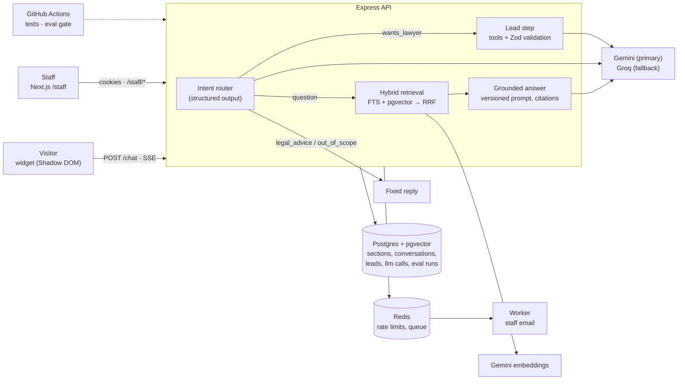
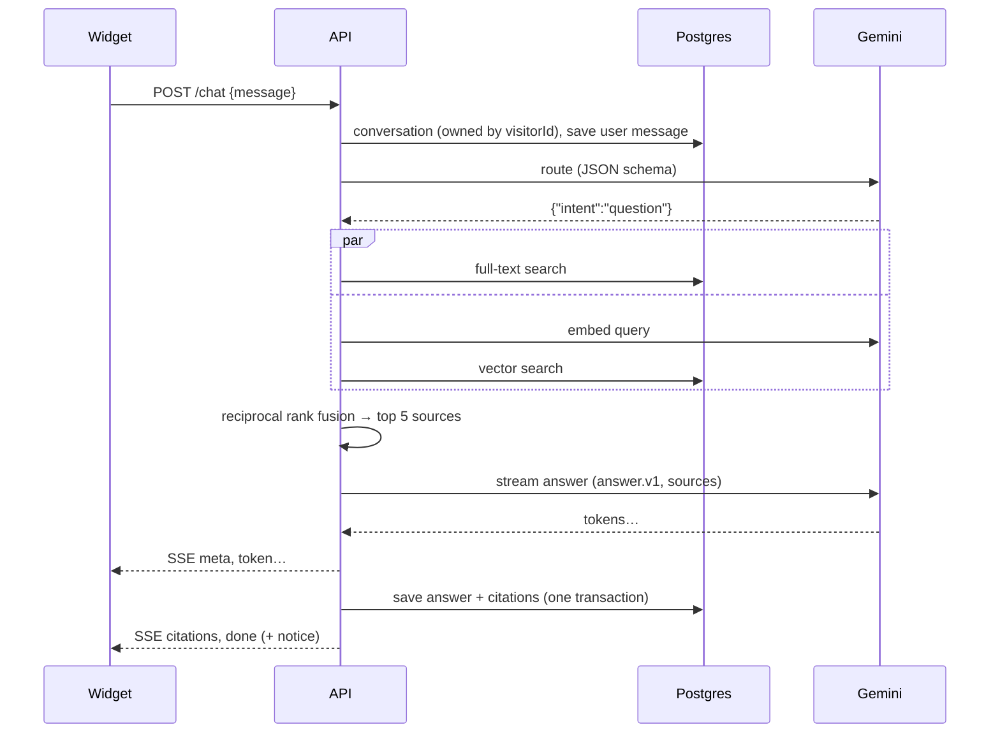

# Phase 39 — Deliverables: README, architecture, results, known failures, demo video

## 1. Goal

Produce what a reviewer actually reads, in the order they read it (the spec's "What you deliver"):

1. A **live demo link** that works on the first click (cold start explained on the page).
2. A **README** that explains in two minutes what this is, why it's built the way it is, and how well
   it works — with an architecture diagram and the results table.
3. A **known failures** section with real examples.
4. A **2–3 minute demo video**.

Plus the resume bullets, filled with your measured numbers.

## 2. What I will understand after this phase

1. How to present an AI project so the evaluation, not the chatbot, is the headline.
2. How to write claims that are exactly as strong as the evidence.
3. How to demo the failure modes deliberately, not hide them.

## 3. Prerequisites

- Phases 00–38 done; `docs/results.md`, `docs/known-failures.md`, `docs/security.md`, `docs/deploy.md`
  written; the site and API live.

## 4. Files

```
README.md                         NEW  (repo root)
docs/architecture.md              NEW  (diagrams, if the README gets long)
docs/demo-script.md               NEW
docs/phases/README.md             (all phases ticked)
```

## 5. Concepts

**Lead with the evaluation.** Many portfolio chatbots exist; few come with numbers. The README's first
screen states what it does in one sentence, then the headline results (retrieval hit@5, citation
accuracy, refusal accuracy, lead accuracy, first-token latency, cost per 1,000 answers) with a link to
how they were measured. That's what separates this project.

**Claims match evidence.** "Refuses legal advice" is a claim; "refused 10/10 legal-advice traps in the
golden set, including mixed and hypothetical phrasings; see known failures for one it missed in an
earlier version" is evidence. Every number in the README links to `docs/results.md`, and every
limitation you know about is written down — reviewers trust a project that shows its failures far more
than one that claims none.

**The demo shows the hard parts.** A 2–3 minute video can't show everything. Show: a cited answer and
the click to the exact section; a "not on the site" answer; a legal-advice refusal; lead capture to the
staff page; and ten seconds of the eval report. Skip setup and code walkthroughs.

## 6. Steps

### Step 1 — README skeleton

Follow e-commerce's README structure (it worked: highlights first, then architecture, then details),
with sections in this order. Write it from your actual numbers and decisions.

```markdown
# CounselDesk

A website assistant for a (fictional) law firm that answers only from the firm's own pages, cites the
exact section for every fact, refuses legal advice, and hands visitors who want a lawyer to staff —
with an evaluation suite that measures all of it.

**Live demo:** <site URL> · **Staff page:** <site URL>/staff (demo credentials on request) ·
**Video:** <link>

> The API runs on a free tier that sleeps when idle; the first message can take up to a minute.

## Results

<the headline table from docs/results.md for the chosen configuration: hit@5, MRR, citation, facts,
not-found, intent, refusal, lead, first-token p50/p95, tokens/answer, est. cost per 1k answers —
with dataset size and date>. Full experiment table and method: docs/results.md.

## How it works

<architecture diagram — Step 2>
<one paragraph per stage: ingestion, hybrid retrieval + RRF, the intent router and fixed refusals,
grounded streaming answers with citations, lead tools with validation, fallback provider, telemetry>

## Engineering decisions

<6–8 short "Why X?" entries, e.g.: why hybrid search; why RRF instead of score averaging; why a separate
router with fixed refusals; why tools only on the lead path; why no HNSW index; why the same slug
function for anchors; why Gemini primary with Groq fallback and no fallback for embeddings; why
Postgres/pgvector rather than a vector database>

## Evaluation

<the golden dataset (57 cases, categories), what each metric means, how runs are stored, the CI gate,
the noise floor>

## Known failures and limitations

<the 3–5 most instructive entries from docs/known-failures.md, verbatim, plus limitations:
tone not scored; follow-up retrieval heuristic; cross-site cookie trade-off; free-tier cold starts>

## Security

<summary of docs/security.md: injection layers, PII handling, retention, rate limits>

## Tech stack

<table, as in e-commerce's README>

## Running it locally

<docker compose up; env setup; ingest; seed staff; pnpm dev; run tests, evals, e2e>

## Project structure

<the monorepo tree>

## Author
```

### Step 2 — Architecture diagram (Mermaid, renders on GitHub)



and a sequence diagram for one answer:



### Step 3 — Demo video script, `docs/demo-script.md`

| Time      | Show                                                                                   | Say (roughly)                                                                                                                                               |
| --------- | -------------------------------------------------------------------------------------- | ----------------------------------------------------------------------------------------------------------------------------------------------------------- |
| 0:00–0:15 | The site, open the widget                                                              | "A website assistant for a law firm. It only answers from the firm's pages, cites them, refuses legal advice, and hands people who want a lawyer to staff." |
| 0:15–0:45 | "How much is a first DUI?" → streamed answer → click `[1]` → highlighted section       | "Every fact is cited; the link opens the exact section it came from."                                                                                       |
| 0:45–1:00 | "Do you take Bitcoin?" → not-found sentence                                            | "When the site doesn't say, it says so instead of guessing."                                                                                                |
| 1:00–1:15 | "Will I go to jail?" → refusal + offer                                                 | "A classifier routes legal-advice questions to a fixed refusal — the answer model never runs."                                                              |
| 1:15–1:45 | "yes please" → name, phone, case → confirmation; staff page: lead, transcript, resolve | "Lead capture uses tool calls, validated on the server and idempotent; staff get an email and a queue."                                                     |
| 1:45–2:20 | `docs/results.md` table; a CI run with the eval gate                                   | "57 golden cases, measured per stage; experiments changed one thing at a time; a subset gates every push."                                                  |
| 2:20–2:40 | `docs/known-failures.md`, one entry                                                    | "Here's one it still gets wrong, and why."                                                                                                                  |
| 2:40–2:50 | Repo README                                                                            | "Code, results and decisions are in the README."                                                                                                            |

Record at 1080p, browser zoomed to 125%, no notifications; trim silences. Upload unlisted and link it.

### Step 4 — Resume bullets

Fill the brackets with your measured numbers; delete any bullet you can't back with a number or a link.

- Built CounselDesk, a RAG website assistant (TypeScript, Express, PostgreSQL/pgvector, Next.js) that
  answers only from a firm's site with per-sentence citations, scoring [X]% retrieval hit@5 and [Y]%
  citation accuracy on a [N]-case golden evaluation set.
- Implemented hybrid search (Postgres full-text + pgvector, hand-written Reciprocal Rank Fusion),
  improving hit@5 from [A]% (vector-only) to [B]% in controlled single-variable experiments.
- Enforced legal-advice refusals with a structured-output intent router and fixed replies ([R]% refusal
  accuracy incl. adversarial phrasings) and LLM tool calling for lead capture with server-side
  validation and constraint-backed idempotency.
- Built provider-agnostic LLM infrastructure (Gemini primary, Groq fallback) with timeouts, jittered
  retries, pre-first-token stream fallback and per-call cost/latency telemetry (p50 first token [T] ms,
  ~$[C] per 1,000 answers at list prices).
- Shipped with CI (unit, integration against Postgres/Redis containers, Playwright E2E, and an eval gate
  on every push), Docker, and deployment on Render/Neon/Vercel.

### Step 5 — Final checklist against the spec

- [ ] Live demo link works; cold-start notice explains the wait
- [ ] Visitor journey from the spec works end to end: cited answer → refusal → not-found → lead
- [ ] Staff page lists leads and conversations needing a human
- [ ] 40–60 test questions of the four types, plus injection cases — scored for retrieval, citation,
      refusal, lead capture, latency and tokens
- [ ] Before/after results table for one-variable changes (search method, section size, prompt version)
- [ ] A part of the suite runs on every push
- [ ] README with architecture diagram and results table
- [ ] Known failures section with real examples
- [ ] 2–3 minute demo video
- [ ] All phase checkboxes in `docs/phases/README.md` ticked

## 7. Commit points

1. `docs: add readme with results, architecture and decisions`
2. `docs: add demo script`

## 8. Verify

- Open the README on GitHub as a stranger would: diagrams render, every number links to its source,
  the live link works (after a cold start).
- Ask someone who hasn't seen the project to watch the video and say, in one sentence, what makes it
  different. If they don't mention the evaluation, move the results higher in the README and the video.

## 9. Common mistakes

- **A README that starts with installation.** Reviewers stop reading before the interesting part.
- **Numbers without a date, dataset size, or link.**
- **Hiding failures.** One honest, diagnosed failure is more convincing than a perfect score.
- **A 6-minute video.** Nobody finishes it.
- **Resume bullets with unmeasured claims** ("highly accurate", "production-grade").

## 10. Interview prep

**Q: Walk me through your project in two minutes.**
A: (Practice it from the README's first screen: what it does, the headline numbers, one design decision
you're proud of — e.g. making refusals a code path rather than a prompt behaviour — and one failure you
found and how you diagnosed it.)

**Q: What would you do next?**
A: Have specific answers ready from your limitations list — e.g. query rewriting for follow-ups, an LLM
judge for tone scored against human labels, multi-firm tenancy, cursor pagination at scale — and say why
each wasn't needed yet.

## 11. Resume-safe claim

The bullets in Step 4, with every bracket filled from `docs/results.md`.

## 12. Definition of done

- [ ] README published with results and diagrams
- [ ] Known failures and security docs linked from the README
- [ ] Demo video recorded and linked
- [ ] Resume bullets filled with measured numbers
- [ ] The spec checklist in Step 5 complete
